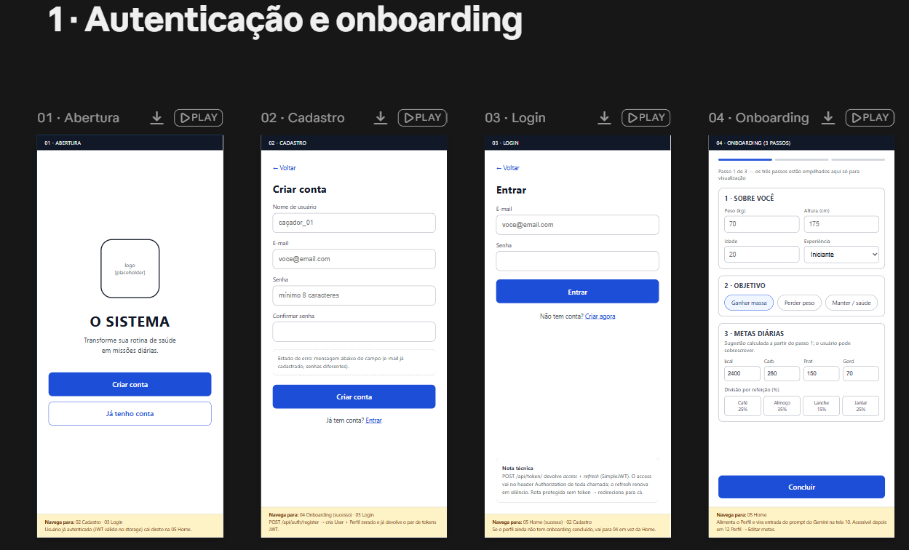
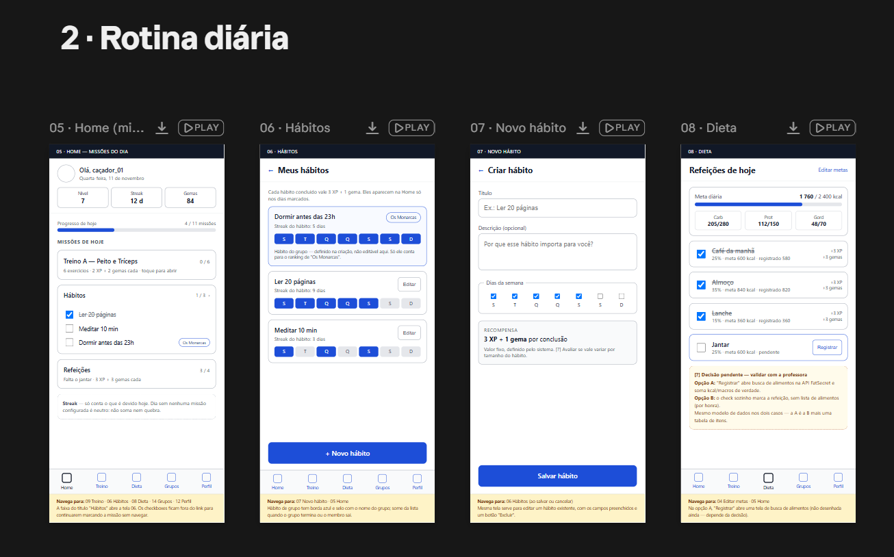
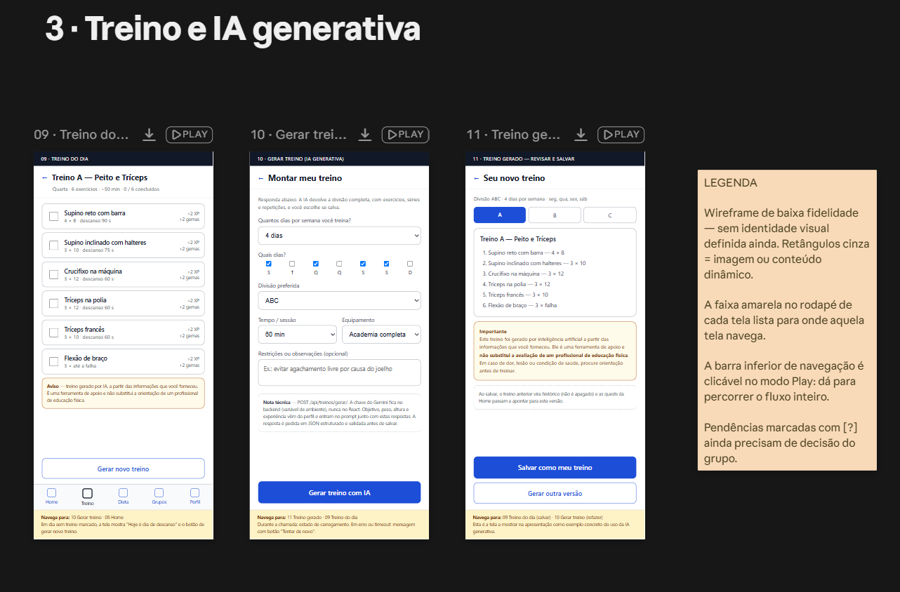
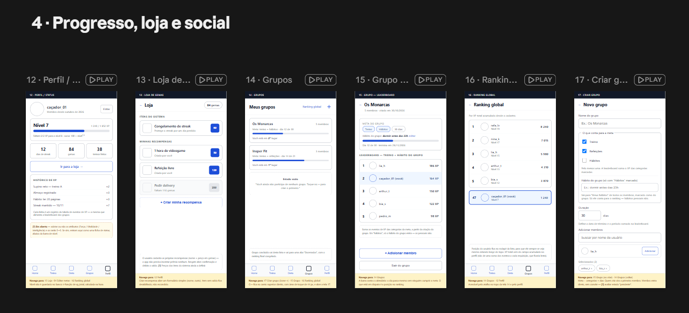

# [NOME DO APP]

> **INTEGRANTES**: Carlos Neto, José Capito, Laura de Oliveira

## Sobre o projeto

O projeto consiste no desenvolvimento de uma plataforma que visa motivar o usuário a aprimorar sua saúde física e mental, através de missões diárias como treinar, comer corretamente ou realizar um hábito pessoal e grupos onde seus participantes competem por metas em comum. O usuário recebe missões, acumula XP, sobe de nível e mantém uma sequência de dias cumpridos (*streak*). O plano de treino que gera parte dessas missões é criado por IA generativa (Google Gemini)

## Problema e público-alvo

**O problema.** Manter constância em hábitos de saúde é difícil. Quem decide começar a treinar e a se alimentar melhor enfrenta duas barreiras logo no início: não saber *o que* fazer e não consegue *sustentar* a rotina depois das primeiras semanas.

**O público-alvo.** Jovens adultos entre 18 e 28 anos, com familiaridade com jogos e cultura pop, que querem cuidar da saúde física e mental mas já tentaram e abandonaram rotinas de treino/dieta. 
> **[CONFERIR]** Ajustem o recorte de idade e o perfil conforme o público que o grupo tem em mente. O importante é que o público seja específico: a professora avalia se a solução oferece uma experiência significativa para um público-alvo definido.

## Proposta de valor

O [NOME DO APP] transforma a rotina de saúde em um sistema de missões com progressão mensurável. O usuário informa seus objetivos, experiência, disponibilidade e a IA generativa monta um plano de treino estruturado e personalizado; esse plano, somado aos hábitos pessoais cadastrados e às metas de alimentação, vira uma lista de missões do dia. Cada missão concluída concede XP, elevando o nível do usuário e alimentando sua streak, e grupos permitem que amigos compitam por uma meta em comum.

**Papel da IA generativa.** A API do Google Gemini é responsável por gerar o plano de treino a partir de um questionário (objetivo, nível de experiência, frequência semanal, dias disponíveis, tempo por sessão e equipamentos acessíveis), e responde com um plano estruturado em divisões, exercícios, séries e repetições.

## Funcionalidades

### MVP

Funcionalidades essenciais para que a proposta funcione de ponta a ponta:

- **Cadastro e autenticação** de usuários com JWT (access e refresh token).
- **Gestão de hábitos**: criar, editar, listar e excluir hábitos, definindo em quais dias da semana cada um está ativo.
- **Geração de treino por IA generativa** (Google Gemini): questionário de perfil, geração do plano estruturado em divisões e exercícios, validação da resposta e persistência.
- **Missões do dia**: tela inicial que reúne apenas os hábitos, a divisão de treino e as refeições aplicáveis à data atual.
- **Conclusão de missões e gamificação base**: registro idempotente de conclusões, concessão de XP (hábito 3 XP, exercício 2 XP, refeição 3 XP, bônus de streak 7 XP), nível derivado do XP total e cálculo de streak.
- **Metas nutricionais e refeições**: metas de calorias e macronutrientes, divisão percentual por refeição e conclusão manual.
- **Perfil e painel de progresso**: XP total, nível atual, progresso até o próximo nível, saldo de gemas e streak.
- **Interface responsiva com Tailwind CSS**, em identidade visual inspirada em HUD de jogo.
- **Deploy público** do frontend e do backend.

### Opcionais

Funcionalidades que enriquecem a experiência, mas que ficam para depois do MVP estar completo:

- **Grupos com meta e período**: criação de grupos, adição de participantes e leaderboard por uma origem específica de XP.
- **Ranking global** de usuários por XP total acumulado.
- **Gemas, loja de recompensas e proteção de streak**: saldo, compras idempotentes, histórico de movimentações e item que preserva a streak.
- **Integração com API de nutrição** (ex.: FatSecret) para substituir a validação manual das refeições — o modelo de dados já é projetado para permitir essa evolução.

## Fluxo de telas







## Cronograma

Legenda de responsáveis: **A** = [Integrante A], **B** = [Integrante B], **C** = [Integrante C].

### Sprint 1 (10/11 - 13/11)

- [ ] FE-01 — Documentar proposta, público-alvo e cronograma (C)
- [X] FE-02 — Criar fluxo de telas de baixa fidelidade (A, C)
- [ ] FE-03 — Configurar React, Tailwind e estrutura de rotas (A)
- [ ] FE-04 — Criar layout base e identidade visual (C)
- [ ] FE-05 — Implementar telas de cadastro, login e logout (A)
- [ ] FE-06 — Criar home com missões do dia (A)
- [ ] FE-07 — Criar interface de hábitos (C)
- [ ] FE-08 — Criar formulário de geração de treino (A)
- [ ] BE-01 — Configurar Django REST Framework (B)
- [ ] BE-02 — Modelar perfil e entidades principais (B, C)
- [ ] BE-03 — Implementar cadastro e autenticação JWT (B)
- [ ] BE-04 — Implementar API de hábitos (B)
- [ ] BE-05 — Definir contrato e prompt de geração de treino (C)
- [ ] BE-06 — Integrar Gemini e salvar treino gerado (B)
- [ ] BE-07 — Criar endpoint de missões do dia (B)

### Sprint 2 (16/11 - 19/11)

- [ ] FE-09 — Exibir treino e concluir exercícios (A)
- [ ] FE-10 — Criar interface de metas e refeições (C)
- [ ] FE-11 — Criar perfil e painel de progresso (A)
- [ ] FE-12 — Criar telas de grupos e leaderboard (C)
- [ ] FE-13 — Criar ranking global (A)
- [ ] FE-14 — Criar loja de recompensas (C)
- [ ] FE-15 — Revisar responsividade, acessibilidade e acabamento (A, C)
- [ ] FE-16 — Criar testes do fluxo principal do frontend (A)
- [ ] FE-17 — Publicar frontend (A)
- [ ] BE-08 — Implementar conclusões, eventos de XP e nível (B)
- [ ] BE-09 — Implementar cálculo de streak (C)
- [ ] BE-10 — Implementar metas e refeições simplificadas (C)
- [ ] BE-11 — Implementar grupos e leaderboard por objetivo (B)
- [ ] BE-12 — Implementar ranking global (B)
- [ ] BE-13 — Implementar gemas, loja e proteção de streak (C)
- [ ] BE-14 — Revisar permissões, validações e segurança (B)
- [ ] BE-15 — Criar testes automatizados do backend (B, C)
- [ ] BE-16 — Publicar backend e banco de produção (B)

### Entrega (20/11 - 24/11)

- [ ] BE-17 — Documentar execução e endpoints do backend (B)
- [ ] FE-18 — Finalizar README do repositório principal (C)
- [ ] FE-19 — Documentar exemplo de IA no desenvolvimento (Todos)
- [ ] FE-20 — Testar com usuários e preparar apresentação (Todos)

## Tecnologias

**Frontend**
- React
- Tailwind CSS
- React Router

**Backend**
- Python / Django
- Django REST Framework
- Autenticação via JWT
- PostgreSQL (produção) / SQLite (desenvolvimento)

**IA generativa**
- API do Google Gemini

**Infraestrutura**
- Render (deploy de frontend e backend)
- GitHub Projects (quadro de tarefas)

> **[CONFERIR]** Ajustem a lista de bibliotecas conforme o que for efetivamente usado (biblioteca de requisições HTTP, ferramenta de testes, etc.).

## Como rodar o projeto

> **[PENDENTE]** Preencher ao final do desenvolvimento (tarefas BE-17 e FE-18). Deve conter: pré-requisitos, instalação de dependências, execução das migrações, variáveis de ambiente necessárias (listadas **sem** valores) e comandos para subir frontend e backend.

### Backend

```bash
# a preencher
```

### Frontend

```bash
# a preencher
```

### Variáveis de ambiente

| Variável | Onde | Descrição |
| --- | --- | --- |
| `GEMINI_API_KEY` | backend | Chave da API do Google Gemini (nunca versionada) |
| `SECRET_KEY` | backend | Chave secreta do Django |
| `DATABASE_URL` | backend | String de conexão do banco de produção |
| `VITE_API_URL` | frontend | URL base da API |

> **[CONFERIR]** Completar e corrigir os nomes das variáveis conforme a implementação.

## Deploy

> **[PENDENTE]** Adicionar os links após o deploy (tarefas BE-16 e FE-17). O link do deploy no README é requisito do conceito A.

- **Frontend:** a publicar
- **Backend (API):** a publicar